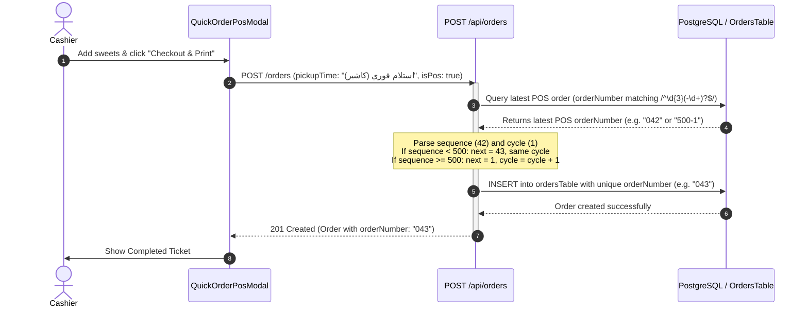

# 📝 Specification: Cashier Quick Order Counter (001–500 Cyclic Sequence)

**Document:** `docs/specs/cashier-quick-order-counter-spec.md`  
**Status:** 🟡 Pending User Review  
**Author:** Pair Programming Assistant & User  
**Target:** Quick Order POS Modal, Printable Receipt, Cashier Checkout, Orders Queue & Search  

---

## 1. Goal & Value Proposition

Provide a separate, fast, and human-friendly order numbering sequence for **Cashier Direct Walk-in Orders (Quick POS)**:
- Instead of the 5-digit online customer order codes (e.g., `83921`), cashier counter orders receive short, 3-digit padded numbers: **`001` to `500`**.
- Once **`500`** is reached, the sequence resets back to **`001`** seamlessly on the 501st order.
- To prevent database collisions with previous cycles and keep past order history distinct, each cycle is visibly tracked (e.g. Cycle 1: `001`–`500`, Cycle 2: `001-2`–`500-2`, Cycle 3: `001-3`–`500-3`).
- Printed receipts and counter display highlight the clean `#001` number prominently so counter staff and customers have immediate clarity.

---

## 2. Requirements & Business Rules

### 2.1 Scope & Order Categorization
- **Quick POS Orders Only:** Only orders placed through the Cashier Quick POS modal (`QuickOrderPosModal` with `createdBy: admin`, `pickupTime: 'استلام فوري (كاشير)'`, or counter cashier notes) use this 001–500 counter.
- **Online Customer Orders Unaffected:** Regular web customers booking Eid sweets continue to receive unique 5-digit codes (`10000` to `99999`) with overflow protection.

### 2.2 Sequence & Rollover Logic
1. Numbers range from `1` to `500`, padded to 3 digits: `001`, `002`, `003` ... `500`.
2. **Strict Sequential Count:** Each new POS order takes `last_pos_number + 1`.
3. **Rollover Trigger:** On the 501st POS order, the number resets back to `001`, and the cycle increments from `1` to `2`.
4. **Cycle Identification:**
   - **Cycle 1:** Stored as `001` to `500`.
   - **Cycle 2:** Stored as `001-2` to `500-2`.
   - **Cycle N:** Stored as `001-N` to `500-N`.
5. **Database Integrity:**
   - Fits within `ordersTable.orderNumber` (`varchar(32)`).
   - Guaranteed 100% unique across all cycles without needing database schema migrations or removing the UNIQUE constraint.

### 2.3 Search & Retrieval
- Searching `001` in `/admin/orders` or tracking matches `001`, `001-2`, `001-3`, with the newest order listed first.
- Cashier can also search by exact full code `001-2` or customer phone.

---

## 3. UI & Display Formatting

### 3.1 Cashier Ticket & Receipt
- **Primary Display:** Prominent large font `#001` (or `#042`).
- **Cycle Subtitle/Badge:** If `cycle > 1`, displays a clear badge or tag: `دورة 2` / `Cycle 2` or `#001-2`.
- **Thermal Printout:** Large barcode/number header `#001` for quick callout at the delivery counter.

### 3.2 Admin Order Queue & Cards
- Displayed in order queue with POS counter badge: e.g. `كاشير #001` (or `كاشير #001-2`).
- Distinguishable at a glance from 5-digit online pickup reservations (`#83921`).

---

## 4. Technical Architecture & Data Flow

---

## 5. Implementation Roadmap

1. **Backend Generator (`generateNextPosOrderNumber`):**
   - Helper function in `artifacts/api-server/src/routes/eid-sweets.ts`.
   - Detects whether order is Cashier POS.
   - If POS: queries latest POS order within transaction, computes next 3-digit padded number and cycle.
   - If online order: continues using `generateUniqueOrderNumber` (5-digit random).
2. **Unit Tests:**
   - Test starting at `001`.
   - Test sequential increments `001 -> 002 -> 003`.
   - Test rollover: simulated `500` -> next order becomes `001-2`.
   - Test rollover: simulated `500-2` -> next order becomes `001-3`.
3. **Frontend Display Updates:**
   - In `QuickOrderPosModal` completion view, show `#001` (with cycle badge if applicable).
   - In `PrintableReceipt`, ensure POS orders display clean `#001` format.
4. **Bundle & Verification:**
   - Rebuild serverless bundle `api/index.js`.
   - Run typecheck and Vitest tests.
